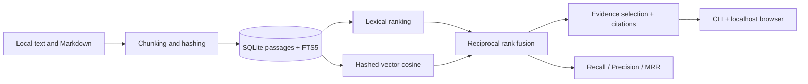

# AtlasRAG Engineering — Local-First Retrieval & Evidence Platform

  

**A substantial, reproducible AI engineering project** for indexing local documents, hybrid retrieval, traceable evidence responses, retrieval benchmarking, and a minimal web interface. No API keys, cloud infrastructure, or proprietary datasets required.

> **Important:** This is a retrieval-and-evidence system, **not** an LLM-powered RAG generator. Its "vector" mode uses deterministic feature hashing rather than learned semantic embeddings. Evidence responses quote selected source sentences and may contain irrelevant matches. Do not use as a medical, legal, or security decision system.

## Architecture



## Quick start

```bash
python -m pip install -e .
python -m unittest discover -s tests -v
atlasrag --db demo.sqlite3 ingest data/ai_engineering.txt
atlasrag --db demo.sqlite3 ingest data/computer_vision.txt
atlasrag --db demo.sqlite3 search "How is retrieval evaluated?" --mode hybrid -k 3
atlasrag --db demo.sqlite3 answer "How do transformers process images?"
atlasrag --db demo.sqlite3 serve
```

Visit **http://127.0.0.1:8765** for the evidence explorer. If you prefer not to install, use `python -m atlasrag` in place of `atlasrag`.

## What is implemented

| Layer | Features |
|---|---|
| Data ingestion | TXT/Markdown; deterministic IDs; overlapping chunks; idempotent replacement |
| Storage | SQLite metadata, passages and vector JSON; optional SQLite FTS5 index |
| Retrieval | FTS5 BM25 lexical search; hashed sparse vectors; cosine similarity; reciprocal rank fusion |
| Evidence | Sentence selection, passage IDs, source citations, abstention on no token overlap |
| Evaluation | Recall@k, Precision@k, MRR@k, Hit Rate@k; query-level and aggregate reports |
| Interfaces | CLI, localhost-only HTTP API, minimal browser interface |
| Quality | Standard-library unittest suite, CI workflow, typed boundaries and input validation |

## Evaluation workflow

First ingest documents, then use the generated document IDs in a JSON query set:

```json
[
  {"query": "How is retrieval evaluated?", "relevant_document_ids": ["YOUR_DOCUMENT_ID"]}
]
```

Run `atlasrag --db demo.sqlite3 evaluate your_cases.json --mode hybrid -k 5`. Use `--mode lexical` and `--mode vector` for ablations. **The example `data/eval_cases.json` contains a placeholder ID**; replace it before evaluating.

## API

- `GET /` — interactive evidence explorer
- `GET /api/search?q=your%20query` — ranked passages with sources
- `GET /api/answer?q=your%20query` — extractive evidence with passage citations

The server is intentionally bound to localhost by default. It has **no authentication** and must not be exposed to the public Internet.

## Research and engineering extensions

1. Replace feature hashing with sentence-transformer embeddings and benchmark domain shift.
2. Add an optional LLM answer generator with strict citation verification.
3. Add a curated, held-out query dataset and confidence intervals over multiple collections.
4. Implement permission-aware retrieval, prompt-injection checks, and observability.
5. Add a real reranker, caching, ingestion monitoring and containerized deployment.

## Reproducibility and limitations

- Pure Python and SQLite: no GPU needed, no pretrained weights, no API keys.
- SQLite FTS5 may not be present in all Python builds; fallback lexical token matching is supported.
- Scores from tiny demo collections are illustrative and **not** evidence of state-of-the-art retrieval.
- Passage citations identify text sources, but the extractor is not a fact-checker or entailment verifier.
- Documents are trusted local files; avoid ingesting sensitive or restricted material.

## Project structure

```text
atlasrag/         package, CLI, storage, retrieval, evidence, evaluation, server
 tests/            unit and integration tests
 data/             original synthetic/example documents
 docs/             design and reproducibility notes
 .github/workflows/ continuous integration
```

## License

MIT. Sample documentation text is original and included solely for demonstration.
